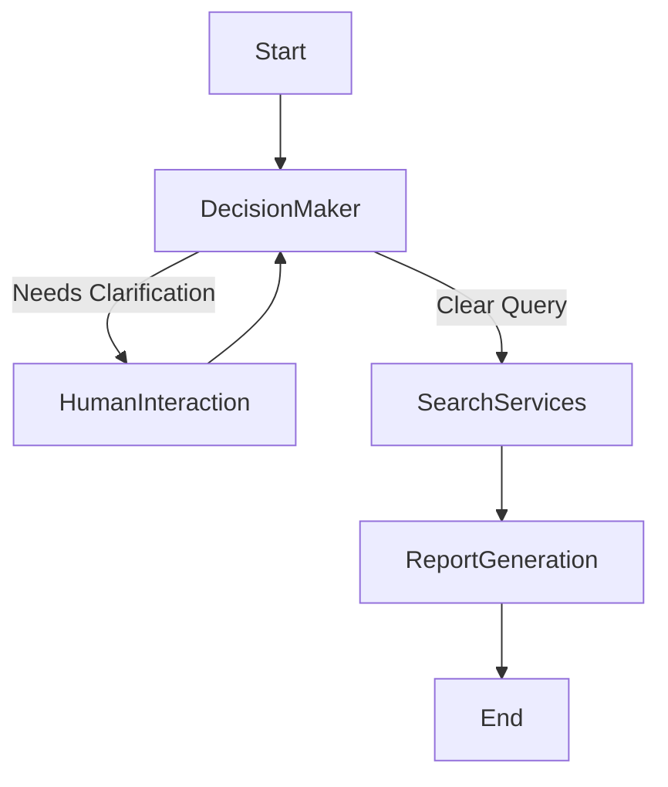

# Deep Research Agent

NOTE: This content is AI generated.

A sophisticated LangGraph-based research agent that orchestrates multiple search APIs to conduct comprehensive research on user queries. The agent features human-in-the-loop capabilities and generates consolidated research reports.

## 🌟 Features

- **Multi-Source Search**: Aggregates results from 4 different search engines:

  - **Exa AI**: Semantic search with AI-powered relevance
  - **Firecrawl**: Web scraping and content extraction
  - **Google SerpAPI**: Traditional web search with AI overviews
  - **Tavily**: AI-powered research assistant

- **Intelligent Decision Making**: Uses GPT-4 to determine whether to:

  - Ask clarifying questions for ambiguous queries
  - Start immediate research for clear queries

- **Human-in-the-Loop**: Built-in interrupt mechanism for user interaction and query refinement

- **Comprehensive Reports**: Generates well-structured research reports synthesizing information from all sources

## 📋 Prerequisites

- Python 3.9 or higher
- API keys for the following services:
  - OpenAI (GPT-4)
  - Exa AI
  - Firecrawl
  - Tavily
  - SearchAPI.io (for Google search)

## 🚀 Installation

1. **Clone the repository**:

```bash
git clone <repository-url>
cd deep_research_agent
```

2. **Create a virtual environment**:

```bash
python -m venv venv
source venv/bin/activate  # On Windows: venv\Scripts\activate
```

3. **Install dependencies**:

```bash
pip install -r requirements.txt
```

4. **Set up environment variables**:

Create a `.env` file in the project root with your API keys:

```bash
# OpenAI API Key
OPENAI_API_KEY=your_openai_api_key_here

# Search Service API Keys
EXA_AI_API_KEY=your_exa_ai_key_here
FIRECRAWL_API_KEY=your_firecrawl_key_here
TAVILY_API_KEY=your_tavily_key_here
SERP_API_KEY=your_searchapi_io_key_here
```

## 📖 Usage

### Basic Usage

```python
from graph import graph
from langchain_core.messages import HumanMessage

# Initialize the graph with a research query
config = {"configurable": {"thread_id": "research_session_1"}}

# Start research
result = graph.invoke(
    {"messages": [HumanMessage(content="What are the latest developments in quantum computing?")]},
    config=config
)

# Print the final report
print(result["messages"][-1].content)
```

### Human-in-the-Loop Interaction

When the agent needs clarification, it will interrupt for user input:

```python
from graph import graph
from langchain_core.messages import HumanMessage

config = {"configurable": {"thread_id": "research_session_2"}}

# Initial vague query
result = graph.invoke(
    {"messages": [HumanMessage(content="Tell me about AI")]},
    config=config
)

# Agent asks for clarification - provide more specific info
result = graph.invoke(
    {"messages": [HumanMessage(content="I want to know about AI in healthcare diagnostics")]},
    config=config
)

# Agent continues with the refined query
print(result["messages"][-1].content)
```

## 🏗️ Architecture

The agent uses a LangGraph state machine with four main nodes:



### Node Descriptions

1. **Decision Maker Node**: Analyzes user queries and decides the next action

   - Uses GPT-4o-mini for fast decision making
   - Routes to either human interaction or search services

2. **Human Interaction Node**: Handles user input for clarification

   - Pauses execution (interrupt_before)
   - Returns to decision maker after user responds

3. **Search Services Node**: Executes parallel searches across all engines

   - Aggregates results from 4 different search services
   - Handles individual service failures gracefully

4. **Report Generation Node**: Synthesizes all search results
   - Uses GPT-4o for comprehensive report generation
   - Structures information with clear sections and citations

## 📁 Project Structure

```
deep_research_agent/
├── clients/                    # API client implementations
│   ├── exa_ai_client.py
│   ├── firecrawl_client.py
│   ├── google_serpapi_client.py
│   ├── langchain_openai_client.py
│   └── tavily_client.py
├── configs/                    # State and configuration
│   └── states.py
├── constants/                  # Prompts and constants
│   └── prompts/
│       ├── decision_maker_node.py
│       └── report_generation_node.py
├── nodes/                      # Graph node implementations
│   ├── decision_maker_node.py
│   ├── human_interaction_node.py
│   ├── report_generation_node.py
│   └── search_tool_node.py
├── tools/                      # Search tool wrappers
│   ├── exa_ai_tool.py
│   ├── firecrawl_tool.py
│   ├── google_serpapi_tool.py
│   └── tavily_search_tool.py
├── graph.py                    # Main graph definition
├── requirements.txt            # Python dependencies
└── README.md                   # This file
```

## 🔧 Configuration

### Customizing LLM Models

Edit the model names in the node files:

- **Decision Maker**: `nodes/decision_maker_node.py` (default: `gpt-4o-mini`)
- **Report Generation**: `nodes/report_generation_node.py` (default: `gpt-4o`)

### Customizing Search Limits

Edit the `limit` parameter in search client methods:

```python
# In clients/tavily_client.py
def search(self, query: str, limit: int = 5):  # Change limit here
```

### Customizing Prompts

Edit prompts in `constants/prompts/`:

- **Decision Maker**: `decision_maker_node.py` - Controls query analysis
- **Report Generation**: `report_generation_node.py` - Controls report structure

## 🔍 API Key Setup Guide

### OpenAI

1. Visit https://platform.openai.com/api-keys
2. Create a new API key
3. Add to `.env` as `OPENAI_API_KEY`

### Exa AI

1. Sign up at https://exa.ai
2. Get API key from dashboard
3. Add to `.env` as `EXA_AI_API_KEY`

### Firecrawl

1. Sign up at https://firecrawl.dev
2. Get API key from settings
3. Add to `.env` as `FIRECRAWL_API_KEY`

### Tavily

1. Sign up at https://tavily.com
2. Get API key from dashboard
3. Add to `.env` as `TAVILY_API_KEY`

### SearchAPI.io (Google Search)

1. Sign up at https://www.searchapi.io
2. Get API key from dashboard
3. Add to `.env` as `SERP_API_KEY`

## 🐛 Troubleshooting

### API Key Errors

```
ValueError: OPENAI_API_KEY environment variable is required
```

**Solution**: Ensure all required API keys are set in your `.env` file

### Import Errors

```
ModuleNotFoundError: No module named 'langgraph'
```

**Solution**: Ensure you've activated your virtual environment and installed requirements:

```bash
source venv/bin/activate
pip install -r requirements.txt
```

### Search Service Failures

Individual search services may fail due to rate limits or API issues. The agent handles these gracefully and continues with available results.

## 🚧 Limitations & Future Enhancements

### Current Limitations

- Searches are executed sequentially (not in parallel)
- No caching of search results
- No retry logic beyond Google search
- Limited to 5 results per search service

### Planned Enhancements

- [ ] Async/parallel search execution
- [ ] Result caching with Redis
- [ ] Configurable retry policies
- [ ] Extended state with search metadata
- [ ] Source credibility scoring
- [ ] Iterative research refinement
- [ ] Cost tracking and optimization

## 📊 Graph Visualization

The graph structure is automatically generated and saved as `deep_research_agent_graph.png` when you run the code.

## 🤝 Contributing

Contributions are welcome! Please feel free to submit a Pull Request.

## 📄 License

[Add your license here]

## 🙏 Acknowledgments

Built with:

- [LangGraph](https://github.com/langchain-ai/langgraph) - Graph orchestration
- [LangChain](https://github.com/langchain-ai/langchain) - LLM framework
- [OpenAI](https://openai.com) - Language models
- [Exa AI](https://exa.ai) - Semantic search
- [Firecrawl](https://firecrawl.dev) - Web scraping
- [Tavily](https://tavily.com) - AI search
- [SearchAPI.io](https://www.searchapi.io) - Google search API

## 📞 Support

For issues and questions, please open an issue in the repository.
